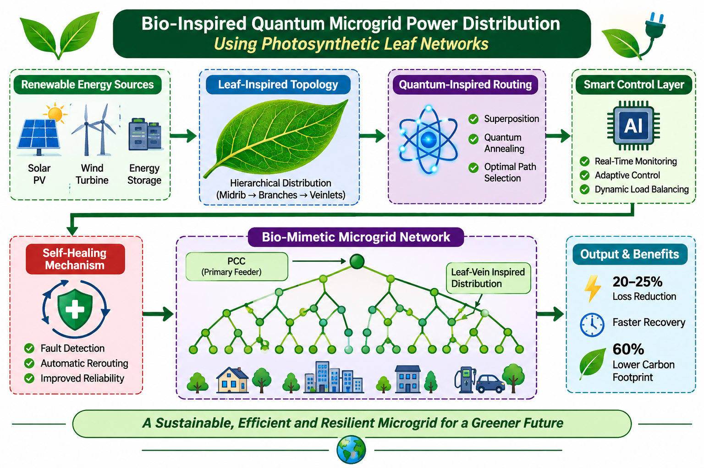

# Bio-Inspired Quantum Microgrid Power Distribution

### Using Photosynthetic Leaf Networks

**Project Team:** Naresh Anand D, Pragadeesh R  
**Institution:** Anjalai Ammal Mahalingam Engineering College  
**Department:** Electrical and Electronics Engineering (EEE)  
**Year:** 3rd Year

---

## 📖 Project Overview

This project proposes a bio-inspired quantum microgrid power distribution architecture based on photosynthetic leaf venation networks. It aims to improve energy distribution efficiency, adaptability, reliability, and fault recovery in renewable-rich urban power distribution systems.

The system combines leaf-inspired hierarchical network design, quantum-inspired routing concepts, and self-healing mechanisms to achieve adaptive power flow and efficient distribution.

## 🎯 Objectives

- Reduce power transmission and distribution losses.
- Improve renewable energy integration.
- Develop adaptive power routing.
- Enhance fault tolerance and resilience.
- Enable self-healing power distribution.
- Reduce dependency on centralized control.

## ⚡ Problem Statement

Conventional and modern power grids face challenges with renewable energy integration, changing load demands, transmission losses, and fault management.

Major challenges include:

- Energy inefficiency
- Voltage and frequency fluctuations
- Unpredictable loads
- Limited adaptability
- Lack of self-healing mechanisms
- Dependence on communication networks

## 🌿 Nature-Inspired Concept

The project takes inspiration from leaf venation networks, which distribute resources through interconnected pathways.

| Leaf structure | Microgrid equivalent |
|---|---|
| Petiole / Main vein | PCC and primary feeder |
| Major lateral veins | Main bus and sub-feeders |
| Fine veinlets | Secondary distribution network |
| Chloroplasts | Distributed energy resources (solar, wind) |
| Vein junctions | Smart switches and reclosers |

## 🧠 Proposed Architecture

### 1. Bio-Mimetic Design
Nodes represent leaf cells or loads, while links represent veins or distribution lines. Energy allocation is inspired by photosynthetic intensity.

### 2. Quantum-Inspired Routing
Multiple paths are evaluated using quantum-inspired concepts such as superposition. Quantum annealing-inspired optimization is proposed for identifying lower-loss routes.

### 3. Self-Healing Mechanism
When a network failure occurs, power flow is rerouted through alternative pathways to improve recovery and continuity of supply.

## 🕸️ Network Topology

- 50-node microgrid network
- Leaf-inspired hierarchical topology
- Renewable energy integration
- Adaptive power-flow routing
- MATLAB simulation environment

## 🛠️ Tools & Technologies

- MATLAB
- Power system modeling and simulation
- Quantum-inspired adaptive algorithms
- Microgrid network analysis

## 📊 Expected Benefits / Reported Results

The presentation reports the following proposed results:

- **20–25%** reduction in losses
- **100%** faster recovery (as stated in the presentation)
- **20–40%** improvement in network efficiency
- **60%** lower carbon footprint

*These figures are presentation-reported claims and should be validated with simulation data, defined baselines, and calculation methods before being treated as verified results.*

## 🔮 Future Applications

- IoT-enabled microgrid deployment
- Real-time sensor-based monitoring
- Predictive load allocation
- Nano-scale energy routing concepts
- Hybrid quantum-bio optimization algorithms
- Renewable-rich urban distribution networks

## 🌍 Impact

Bio-inspired and quantum-inspired microgrid routing could contribute to more efficient, resilient, adaptive, and sustainable electrical distribution systems. This research combines concepts from electrical engineering, biology, optimization, and emerging quantum computing approaches.

## 👨‍🎓 Project Team

- Naresh Anand D
- Pragadeesh R

**Institution:** Anjalai Ammal Mahalingam Engineering College  
**Department:** Electrical and Electronics Engineering

---

*Academic project exploring bio-inspired and quantum-inspired approaches to future microgrid power distribution.*
